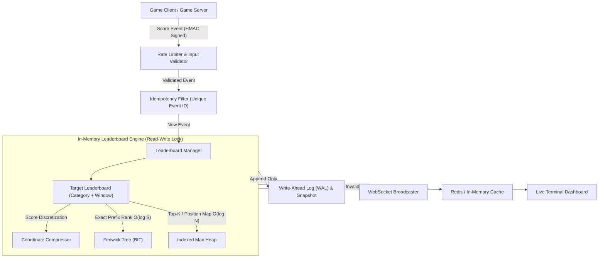

# Project 04: Real-Time Game Leaderboard (Ranking Engine) - Architecture Specification

## 1. Executive Summary
**Project 04: Real-Time Game Leaderboard** is an industrial-grade, in-memory ranking engine engineered in modern C++17. It manages competitive player rankings across multiple categories, handles dynamic score ingestion with sub-millisecond latencies, and computes exact competition rankings ("1224" rule) using Fenwick Trees and Indexed Max Heaps.

---

## 2. System Pipeline & Data Flow

---

## 3. Data Structure Responsibilities

| Data Structure | Primary Responsibility | Big-O Time Complexity | Memory Complexity |
| :--- | :--- | :--- | :--- |
| **Fenwick Tree (BIT)** | Prefix frequency aggregation, exact competition rank, and binary lifting `select(k)` | $O(\log S)$ per update/query | $O(S)$ where $S$ = distinct scores |
| **Coordinate Compressor** | Mapping arbitrary online score domains into contiguous 1-based indices with sorted pending buffers | $O(\log S)$ query, $O(S \log S + N)$ amortized rebuild | $O(S)$ |
| **Indexed Max Heap** | Direct Top-K player retrieval ($K \le 100$) and bidirectional position map for instant updates | $O(1)$ peek, $O(\log N)$ update/remove | $O(N)$ where $N$ = players |
| **Doubly-Linked Buckets** | Maintaining strict display tie-break order `(score DESC, timestamp ASC, player_id ASC)` | $O(1)$ append / remove | $O(N)$ |
| **HashMap** | $O(1)$ player ID lookup and case-insensitive username index | $O(1)$ average | $O(N)$ |
| **Append-Only WAL** | Zero-data-loss durability with CRC32 checksums | $O(1)$ append | $O(\text{events})$ |

---

## 4. Ranking Policies & Formulas

### Competition Rank ("1224" Rule)
$$\text{Rank}(P) = 1 + \sum_{s > \text{score}(P)} \text{Frequency}(s)$$
* Worked Example: Scores $[100, 90, 90, 80]$ yield ranks $[1, 2, 2, 4]$.

### Dense Rank ("1223" Rule)
$$\text{DenseRank}(P) = 1 + \text{Count of Distinct Scores Above } \text{score}(P)$$
* Worked Example: Scores $[100, 90, 90, 80]$ yield dense ranks $[1, 2, 2, 3]$.

### Strict Display Tie-Break Total Order
$$\text{Entry}_A \succ \text{Entry}_B \iff (\text{score}_A > \text{score}_B) \lor (\text{score}_A = \text{score}_B \land \text{time}_A < \text{time}_B) \lor (\text{score}_A = \text{score}_B \land \text{time}_A = \text{time}_B \land \text{id}_A < \text{id}_B)$$

### Percentile Standing
$$\text{Percentile}(P) = 100.0 \times \frac{N - \text{Rank}(P)}{N}$$
